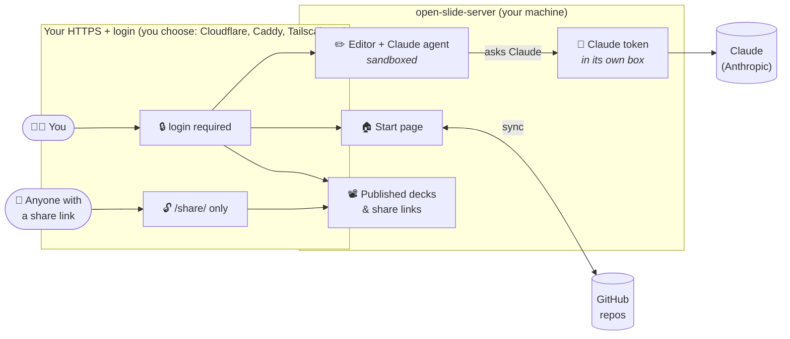
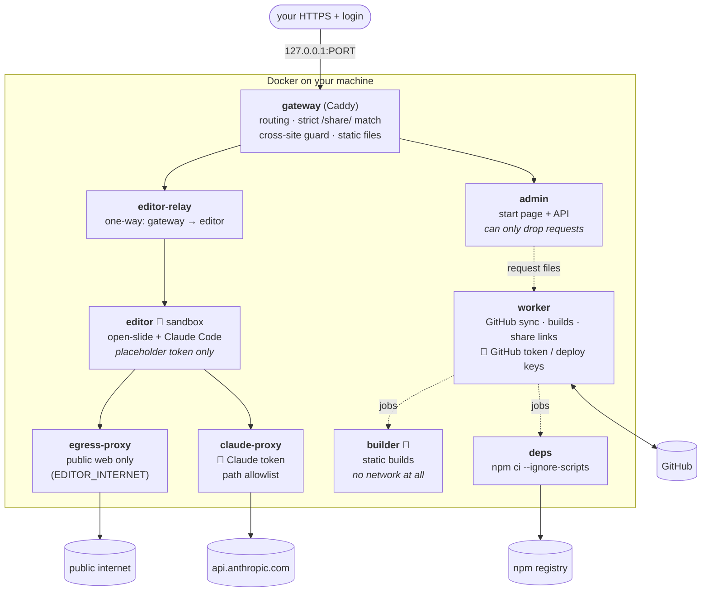
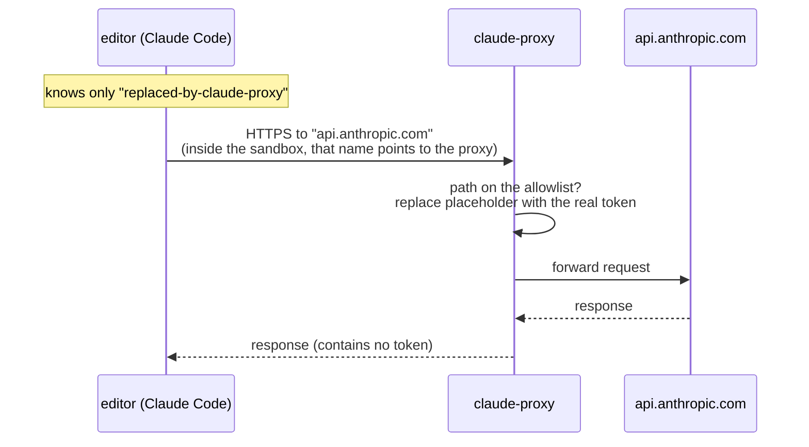

<p align="center"></p>

<h1 align="center">open-slide-server</h1>

<p align="center">
Your own <a href="https://open-slide.dev">open-slide</a> server: write slide decks with Claude, keep them in GitHub,<br>
present them anywhere, and share single decks with one link. Without handing your Claude account to the code you run.
</p>

---

## What you get

- **An editor with the Claude agent.** Ask Claude to draft, restyle or fix your decks. It uses *your* Claude Pro/Max subscription.
- **A start page.** All your projects and decks, with one click to edit, view or share.
- **Published decks.** Presenter view, animations and every other feature, read-only, behind your login.
- **Share links.** Send one deck to anyone, no account needed. Links expire and can be revoked instantly.
- **GitHub sync.** Every project is backed up and synced both ways, so collaborators can work on it too. Branches are supported.

Everything runs from one `docker compose` file on your own server and lives under one address:

| Address | What it is | Who can open it |
|---|---|---|
| `https://slides.example.com/` | start page | you |
| `…/editor/` | editor + Claude agent | you |
| `…/slides/` | your published decks | you (and whoever your login allows) |
| `…/share/<random-link>/` | a single deck | anyone you send the link to |

## How it works



**In one paragraph:** your login decides who gets in. Share links are the only door without a login,
and they open nothing but a finished, read-only deck. The editor, where the Claude agent works and
your repos' code runs, sits in a sandbox. It can ask Claude for help, but your Claude token is
locked in a separate box that the editor can't open. GitHub access lives in yet another place
that never runs any repo code.

## Why you can trust it

| Worry | What protects you |
|---|---|
| *"Someone finds my URL."* | Everything except share links sits behind **your** login. A check script tells you if anything is open ([test](#3-protect-it-and-test-it)). |
| *"Someone guesses a share link."* | Links are 128-bit random (like a strong password), show exactly one read-only deck, expire, and stop working the moment you revoke them. Wrong links get a plain "not found". |
| *"A repo or slide contains malicious code and steals my Claude subscription."* | The editor never holds your Claude token. It only has a placeholder; a separate proxy, which runs no repo code, swaps in the real token on the way to Anthropic. The token can't be read, copied or turned into another key. |
| *"…steals my GitHub access."* | GitHub credentials live only in the sync worker, which never runs repo code. Git hooks and filters are disabled. |
| *"…attacks my server or home network."* | The editor has no route to your host or your local network, and its web access goes through a filter that only allows public addresses. Nothing runs as root, every container is read-only, and nothing can control Docker. |
| *"…messes with my other projects."* | The editor and the builder only ever see the one project you have open. |
| *"Another website tricks my browser into acting on my start page."* | Requests from other sites are refused, except plain links. |
| *"I can't verify any of this."* | Everything is in this repo (shell, Python, a little JavaScript, Caddy configs), and `scripts/check.sh` tests these properties on your running server. |

What it **doesn't** protect against is spelled out in [Limits](#limits), honestly.

> [!CAUTION]
> **open-slide-server has no login of its own; that part is yours.** It only listens on
> `127.0.0.1`. If you expose the start page or the editor **without** a login, anyone who finds the URL can
> use your Claude subscription, read and delete your decks, push to your GitHub repos and create share links.
> Your Claude token itself would still stay hidden, but everything it unlocks would be open.
> Follow [step 3](#3-protect-it-and-test-it), and don't skip the test.

## Setup

You need a Linux machine (a small VPS or a home server) with Docker Engine and Compose v2 and about
2 GB of free RAM, a Claude Pro/Max subscription, and a domain name, or Tailscale for a private setup.

### 1. Install

```sh
git clone https://github.com/ValentinHerrmann/open-slide-server.git
cd open-slide-server
./setup.sh
```

`setup.sh` asks for your address (e.g. `https://slides.example.com`) and a local port. It downloads
the prebuilt images, prepares `./data`, starts everything and runs a self-check. Re-running it is safe.

### 2. Connect Claude

On **any** computer with [Claude Code](https://www.npmjs.com/package/@anthropic-ai/claude-code) installed, run:

```sh
claude setup-token
```

Log in with your Claude subscription and copy the token it prints (valid for one year). You'll paste it
on the start page under **Settings → Claude** after step 3. It's stored where only the Claude proxy can
read it, and never shown again.

### 3. Protect it and test it

Put HTTPS and a login in front. The generator writes a ready-to-run config for the setup you pick,
into `./protect/`, and prints the remaining steps. It changes nothing outside that folder:

```sh
sh scripts/protect.sh
```

| # | Setup | Choose it if… | Effort |
|---|---|---|---|
| 1 | **Cloudflare Tunnel + Access** ⭐ | you want it reachable from anywhere, with no open ports. Login by email code, Google or GitHub. | ~20 min, free; domain on Cloudflare |
| 2 | **Caddy + Cloudflare** | you run your own Caddy on a public IP and want the most defensive setup: Cloudflare Access, plus Caddy only accepting Cloudflare and checking the login token itself. | ~30 min, free; domain on Cloudflare |
| 3 | **Caddy + basic auth** | you want the quickest start on a server with a public IP: one generated strong password. | ~10 min |
| 4 | **Tailscale only** | only you, on your own devices. Share links then also work only inside your tailnet. | ~5 min |
| 5 | **Caddy + SSO** (Authelia, authentik, oauth2-proxy) | you already run single sign-on. | 30–60 min |

Details for each: [docs/ingress.md](docs/ingress.md). **Then test from the outside:**

```sh
sh scripts/test-protection.sh https://slides.example.com
```

It must report every page as "login required", except the share-link check. If it says **OPEN**,
run `docker compose stop` and fix your setup first. Finally, open the address in a private browser
window once: you should see your login.

### 4. Start working

Open your address, paste the Claude token under **Settings → Claude**, and click **Open editor** on
your first project. Connecting projects to GitHub, branches, publishing and share links:
[docs/usage.md](docs/usage.md).

> This is a **single-user** tool built on your personal Claude subscription. Collaborate through
> GitHub and share links. Don't give others access to your editor.

---

## Under the hood

### Components



🧪 = runs code from your repos (Vite config, decks, the agent's tools). Every container runs as a
non-root user with a read-only filesystem and no Linux capabilities, and none of them can control Docker.

| Container | Holds | Can reach | Runs repo code? |
|---|---|---|---|
| gateway | nothing secret | admin, editor-relay | no |
| admin | nothing | only its request folder | no |
| worker | GitHub token, deploy keys | GitHub | **no** (git hooks off, git dir outside the worktree) |
| editor | **placeholder** Claude token, one project | claude-proxy, egress-proxy. **Not** the host, LAN, gateway or admin | **yes** |
| claude-proxy | **Claude token** | api.anthropic.com, allowlisted paths only | no |
| egress-proxy | nothing | public addresses on ports 80/443; nothing with `EDITOR_INTERNET=off` | no |
| builder | nothing, one project read-only | **nothing** (no network) | **yes** |
| deps | nothing, one project | npm registry | no (install scripts disabled) |

### How the Claude token stays out of reach



- The token is saved through the start page into `data/claude/token`. Only claude-proxy mounts that folder.
- Inside the editor, `api.anthropic.com` is a network alias for claude-proxy. The editor trusts the proxy through the proxy's own CA certificate; the CA's key never leaves the proxy. So *every* call Claude Code makes (chat, account policy, web-fetch checks) passes the proxy.
- Only an allowlist of Anthropic API paths is forwarded. Endpoints that would turn the token into another credential (creating API keys, refreshing OAuth tokens) are refused.
- The editor has no other route out: an internal Docker network with no host IP on the bridge. Its only exits are claude-proxy and egress-proxy.

### Share links and published decks

- Decks are built by the **builder** into static files. It has no network and sees one project read-only. The output is sanitized: no symlinks, only regular files.
- The gateway serves `/share/<22 characters>/…` strictly. Dot segments and encoded slashes are refused, so a share URL can never reach anything other than its deck. Unknown or revoked links get a plain 404, and share pages are never cached.
- Published decks under `/slides/` are the same kind of static build, behind your login.

### Repos you open

An open-slide project **is code**: its Vite config, its decks, and `.claude/settings.json` hooks all run
when you open it. That code is contained as described above. Within that sandbox, it can:
- change that project's files (visible in its git history)
- use your Claude quota through the proxy
- with `EDITOR_INTERNET=on`, send that project's contents to the internet

### Limits

Honest list of what this setup does **not** do:
- **No login of its own.** That part is yours ([step 3](#3-protect-it-and-test-it)).
- **Open only repos whose authors you trust.** Besides the server-side limits above, decks run as JavaScript in your browser on the same site as the start page. While you have a malicious deck open, it could click buttons on the start page *as you*, e.g. create share links. It still can't read your tokens.
- **`EDITOR_INTERNET=on`** (the default) lets the agent and repo code reach public websites: web fetch, MCP servers, plugins, `npm install`. Set it to `off` for a stricter sandbox; web search keeps working.
- **One person per server.** Your Claude subscription is personal.

### Verify it yourself

```sh
sh scripts/check.sh             # on the server: sandbox, token isolation, share links, containers
sh scripts/test-protection.sh https://slides.example.com   # from anywhere: is your login in front?
```

`check.sh` tests, among others:
- The editor can't reach the host, private addresses, the gateway or the admin.
- The editor holds only the placeholder token, and no credentials exist in its files.
- The Claude proxy refuses paths outside its allowlist.
- Share-link path tricks fail.
- No container has the Docker socket or runs as root.
- Claude answers through the proxy.

## Configuration

`.env` (written by `setup.sh`, documented in `.env.example`):

| Setting | Default | Meaning |
|---|---|---|
| `PUBLIC_URL` | (none) | The address you open, e.g. `https://slides.example.com` |
| `BIND`, `PORT` | `127.0.0.1`, `8080` | Where the gateway listens for your HTTPS/login proxy |
| `EDITOR_INTERNET` | `on` | Web access for the editor/agent (through the filter); `off` = none |
| `CYCLE_SECONDS` | `120` | How often projects sync with GitHub and republish |
| `OPEN_SLIDE_VERSION` | `latest` | Image version from ghcr.io; `local` + `docker compose build` to build yourself |

## Operations

```sh
docker compose ps                                        # status
docker compose logs -f worker                            # sync / build log (also on the start page)
git pull && docker compose pull && docker compose up -d  # update
```

- **Backup:** `./data`. It contains your tokens, so keep backups private. Projects connected to GitHub are on GitHub as well.
- **New Claude token:** **Replace token** on the start page. It takes effect immediately.
- **Public GitHub Pages:** `templates/github-pages.yml` publishes a repo's decks **publicly**, if you ever want that.

## License

MIT, see [LICENSE](LICENSE). Built on [open-slide](https://open-slide.dev) (MIT, © Yiwei Ho); the logo
in `admin/icons/` is open-slide's. Claude Code is installed from npm (`@anthropic-ai/claude-code`) under
Anthropic's terms; you use it with your own subscription.
